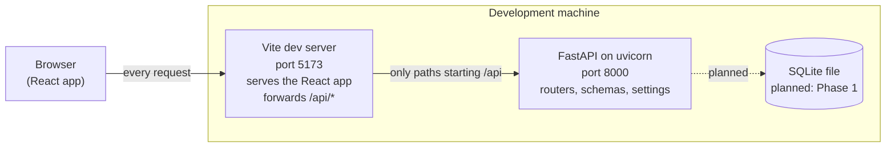
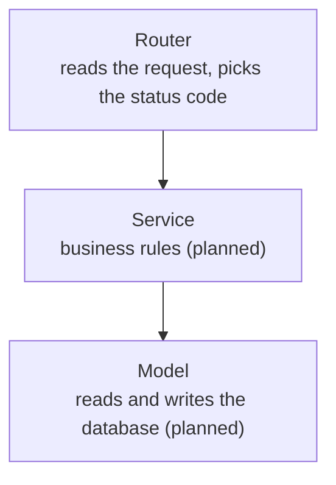

# Architecture

How Exercive fits together today, and where the planned parts will go. Decisions and the
reasons behind them are logged in [PROGRESS.md](PROGRESS.md).

> **Status:** Phase 0. Only the parts drawn with solid lines exist. Dashed lines and
> "planned" rows are the intended design, not working code.

## The big picture

Two programs run side by side during development. The browser only ever talks to the
frontend's address (port 5173). The frontend's dev server answers page and asset requests
itself and forwards every request whose path starts with `/api` to the backend (port 8000).



**Why one address for the browser?** Phase 2 stores the login session in an httpOnly cookie.
Browsers such as Safari block cookies when the page and the API are on different sites. If the
browser only ever sees one origin, the cookie is a normal same-site cookie. That is why every
backend route lives under `/api` and why the proxy exists.

## What lives where

| Folder                          | Responsibility                                          | Status  |
| ------------------------------- | ------------------------------------------------------- | ------- |
| `backend/app/main.py`           | Builds the FastAPI app and registers routers            | Built   |
| `backend/app/config.py`         | Typed settings read from environment variables          | Built   |
| `backend/app/routers/`          | HTTP layer: URLs, methods, status codes                 | Health  |
| `backend/app/schemas/`          | Shape of data going in and out (Pydantic)               | Health  |
| `backend/app/services/`         | Business rules, independent of HTTP                     | Planned |
| `backend/app/models/`           | Database tables (SQLAlchemy)                            | Planned |
| `backend/app/seed/`             | Imports the exercise dataset                            | Planned |
| `backend/tests/`                | pytest tests                                            | Built   |
| `frontend/src/api/`             | One file per group of endpoints; components never build URLs | Health |
| `frontend/src/pages/`, `hooks/`, `components/` | Screens, reusable logic, UI pieces       | Planned |

The backend is built in layers, and each layer only talks to the one below it:



Today the health route is the only route and it needs no rules or data, so it skips the lower
layers. They get added the first time a feature needs them (Phase 1 onwards), not before.

## The life of a health request

One request, `GET /api/health`, from page load to the words changing on screen:

1. **The page loads.** The browser gets the React app from the Vite dev server (port 5173),
   and React draws the `App` component ([App.tsx](../frontend/src/App.tsx)).
2. **`App` asks for the status.** Its `useEffect` runs right after the first draw and calls
   `fetchHealth()`. The screen shows "loading" in the meantime.
3. **The browser sends the request.** `fetchHealth()` ([health.ts](../frontend/src/api/health.ts))
   calls `fetch('/api/health')`. The URL has no host, so the browser fills in the one it's on:
   `http://localhost:5173/api/health`. The request goes to port 5173, not 8000.
4. **Vite forwards it.** The path starts with `/api`, which matches the proxy rule in
   [vite.config.ts](../frontend/vite.config.ts), so Vite passes the request on to
   `http://localhost:8000/api/health`.
5. **uvicorn receives it.** It reads the raw HTTP text and hands it to the FastAPI `app`
   object ([main.py](../backend/app/main.py)).
6. **FastAPI finds the route.** `main.py` mounts the health router under the prefix `/api`,
   and the router declares `/health`, so together they match `GET /api/health`
   ([health.py](../backend/app/routers/health.py)). Before running `read_health`, FastAPI sees
   `Depends(get_settings)`, calls that function, and passes the result in as `settings`.
7. **The route answers.** `read_health` returns a `HealthResponse`. FastAPI checks it against
   that schema ([schemas/health.py](../backend/app/schemas/health.py)) and turns it into JSON
   text, `{"status":"ok","environment":"development"}`, with status 200.
8. **The answer travels back** the same way: uvicorn, then Vite, then the browser.
9. **The page updates.** `fetchHealth()` sees a 2xx status (`response.ok`), parses the JSON
   text into a JavaScript object, and `App` stores it with `setApiStatus`. Changing state makes
   React redraw, and the card shows "Connected (development)". Any failure along the way ends
   in the `.catch` instead, and the card shows "API unreachable".

You can prove the two halves separately from a terminal, with both servers running:

```sh
curl http://localhost:8000/api/health   # straight to FastAPI
curl http://localhost:5173/api/health   # through the Vite proxy; same JSON
```

> Anatomy of the URL:
>
> ```
> http://localhost:5173/api/health
>
> scheme: http
> host:   localhost
> port:   5173
> path:   /api/health
> ```
>
> The Vite proxy looks at the path and whether the path starts with '/api' to decide whether to forward a request.
    

## Production (planned, Phase 9)

Frontend on Vercel, backend on Render, PostgreSQL on Neon. The SQLAlchemy code is the same as
in development; only `DATABASE_URL` changes. The browser should still see a single origin, so
the production equivalent of the Vite proxy (a rewrite rule on the frontend host) forwards
`/api` to the backend. That is not built yet, and the exact setup will be checked against the
current free tiers when we get there.

## Configuration

Settings come from environment variables, with `backend/.env` as a local convenience. The
committed `backend/.env.example` lists every variable. A wrong value stops the app at startup
instead of failing later. Production has no `.env` file; the same values are set in the
hosting provider's dashboard.
